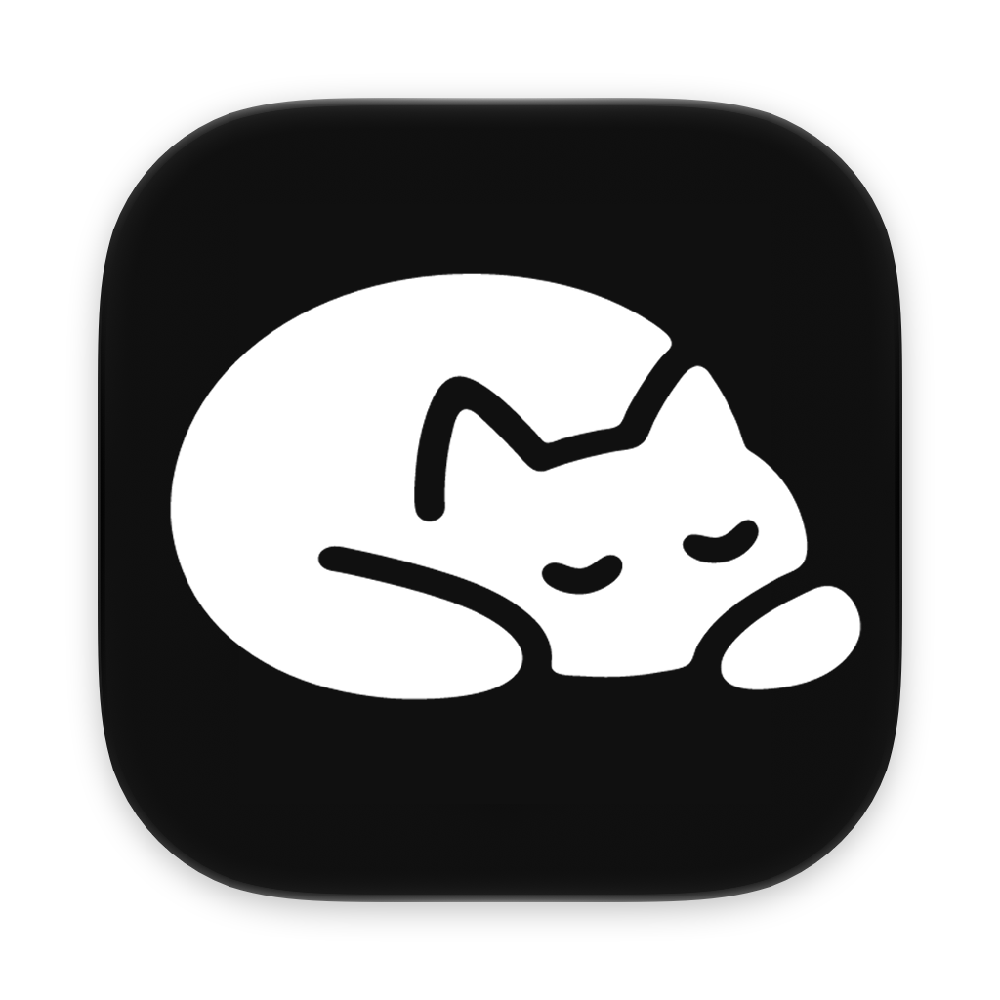

<p align="center"></p>

# Dimmer

A tiny menu-bar app that dims your Mac's screen below the lowest built-in brightness.

Click the sleeping cat in the menu bar and drag the slider. Dimmer darkens the screen and the mouse pointer together. It needs no permissions, makes no network connections and doesn't add itself to Login Items.

## Install

```sh
brew install --cask viktor-workflow/tap/dimmer
```

Or download `Dimmer.zip` from [Releases](https://github.com/viktor-workflow/Dimmer/releases), unzip it and move `Dimmer.app` to Applications. The app isn't notarised by Apple, so the first time, right-click it and choose **Open**.

## Use

- One slider per display, up to 92% so the screen never goes fully black. Levels are remembered per display.
- **Link all displays** keeps every screen at the same level.
- Scroll over the cat to dim or brighten the screen under the pointer, even with the menu closed.
- **Shortcuts:** click **Record…** and press a key combo with ⌘, ⌃ or ⌥ to set Dim more, Dim less or Toggle. None are set by default, and no Accessibility permission is needed.
- **Turn Off / Turn On** pauses dimming and keeps your levels.
- **Dim cursor too** (on by default) dims through the display's colour tables so the pointer dims as well. Turn it off to use a plain black overlay instead. Normal brightness comes back when you quit, and when the Mac sleeps.

To start it at login, add it in System Settings > General > Login Items.

### If the screen doesn't dim properly

Some displays ignore colour-table changes, and HDR, Night Shift, True Tone or other display apps can interfere. Untick **Dim cursor too** to fall back to the overlay (the pointer won't be dimmed then). If the screen ever stays dark after a crash, quitting and reopening Dimmer, or logging out, resets it.

## Build from source

Requires the Xcode Command Line Tools.

```sh
./build.sh   # outputs build/Dimmer.app and build/Dimmer.zip
```

Requires macOS 13 or later. Universal (Apple Silicon and Intel).

## Licence

MIT
